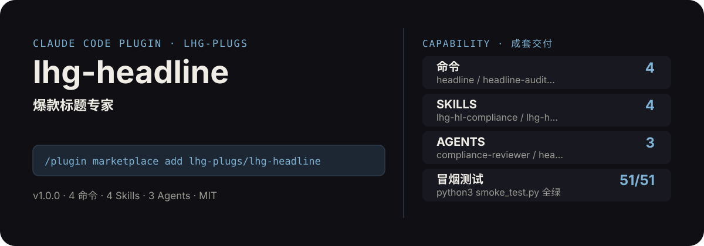

<!-- About 简介（推送后填写到仓库 About 栏）：
爆款标题专家：主题/内容→多平台标题公式生成（悬念/数字/对比/痛点公式库）→敏感词与极限词检测→点击率 rubric 打分，一次配齐。 ｜ 一键安装：/plugin marketplace add lhg-plugs/lhg-headline
-->
<!-- topics（推送后打）：claude-code, claude-plugin, agent-skills, headline, title, copywriting, click-through, compliance -->

<p align="center">
  
</p>

> **一句话介绍**：爆款标题专家：主题/内容→多平台标题公式生成（悬念/数字/对比/痛点公式库）→敏感词与极限词检测→点击率 rubric 打分，一次配齐。

**一键安装**：在 Claude Code 里运行

```bash
/plugin marketplace add lhg-plugs/lhg-headline
/plugin install lhg-headline@lhg-plugs
```

## 它能帮你做出什么

- **冒烟全绿**：`python3 smoke_test.py` 51 项全部通过（JSON 合法、frontmatter 完整、命令/skill/agent 齐全）。

## 它是什么

`lhg-headline` 是一个 Claude Code 插件（plugin 为主、skill 为辅）：

- **4 个命令**（小白入口）：`headline` 主题/内容→多平台标题公式生成、`headline-audit` 标题合规自检、`headline-optimize` 旧标题诊断改写、`headline-variants` 一稿多发
- **4 个平台中立 skill**（方法论，可移植到豆包/Workbuddy 等 agent 平台）：lhg-hl-compliance, lhg-hl-formula, lhg-hl-platform, lhg-hl-score
- **3 个专家 agent**：compliance-reviewer, headline-writer, title-optimizer
- **1 个 hooks**（`hooks/`：check_titles_before_publish.py），关键操作前自动把关

## 为什么是它

不是一个 prompt，而是一套互相兜底的机制：

1. **硬门，不是提醒**：hooks 在关键操作前自动拦截或警告（见 `hooks/`），而不是只在文档里写一句"请注意"。
2. **方法论沉淀在 skill 里**：流程、检查清单、口径都写在 `skills/` 的方法论里，命令只是入口；换个 agent 平台也能复用同一套做法。
3. **可验，不是可信**：`fixtures/` 备有坏/好对照用例，`smoke_test.py` 一键验证，规则有没有生效、自己跑一遍就知道。

## 快速上手

```bash
# 1. 安装（Claude Code 里运行）
/plugin marketplace add lhg-plugs/lhg-headline
/plugin install lhg-headline@lhg-plugs

# 2. 主题/内容→多平台标题公式生成：8 大公式出 5–8 条候选→敏感词/极限词检测
/lhg-headline:headline "年终总结写作" --platform xiaohongshu
```

| 命令 | 作用 | 示例 |
|---|---|---|
| `/lhg-headline:headline` | 主题/内容→多平台标题公式生成：8 大公式出 5–8 条候选→敏感词/极限词检测→点击率 rubric 打分排序… | `/lhg-headline:headline "年终总结写作" --platform xiaohongshu` |
| `/lhg-headline:headline-audit` | 标题合规自检：极限词/标题党/医疗金融绝对化/字数/emoji/关键词堆砌 14+ 条确定性规则扫描… | `/lhg-headline:headline-audit ./titles.json` |
| `/lhg-headline:headline-optimize` | 旧标题诊断改写：拆解旧标题用的公式→定位失分项（钩子迟到/承诺超载/人群错位）→保留有效钩子换公式重出。 | `/lhg-headline:headline-optimize "我的周报心得"` |
| `/lhg-headline:headline-variants` | 一稿多发：已定稿标题→多平台逐字改写（字数/钩子位/黑话/审核红线），每平台 2–3 版。 | `/lhg-headline:headline-variants ./titles.json --platforms xiaohongshu,douyin,wechat` |

## 什么时候用 / 什么时候不用（FAQ）

**什么时候用：**

- 你需要主题/内容→多平台标题公式生成时 → 用 `/lhg-headline:headline`
- 你需要标题合规自检时 → 用 `/lhg-headline:headline-audit`
- 你需要旧标题诊断改写时 → 用 `/lhg-headline:headline-optimize`

**什么时候不用：**

- 你只需要其中一个零散能力时 → 本插件是成套流程，单点需求用更轻量的 skill 更合适
- 你希望 AI 完全自由发挥、不接受任何自查与硬门时 → 它的规则审计与 hooks 会介入（可关，但那就别装它）
- 你的场景不在上面命令表覆盖范围内时 → 先看命令表，没有对应命令就别硬套

## 目录结构

```
lhg-headline/
├── smoke_test.py          # 一键冒烟测试
├── ATTRIBUTION.md         # 灵感来源与许可声明
├── LICENSE                # MIT
├── README.md              # 本文件
├── .claude-plugin/
├── agents/
├── commands/
├── fixtures/
├── hooks/
├── scripts/
├── skills/
```

## 自检与反馈

本插件自带质检：每次使用后可跑 `python3 smoke_test.py` 一键验证（本次实测 51 项全部通过）。

发现 bug 或有改进建议，以 `[QC] <一句话问题>` 为标题提交到 https://github.com/lhg-plugs/lhg-headline/issues，正文写清"复现步骤 → 实际表现 → 期望表现"。

同门插件见 [lhg-plugs](https://github.com/lhg-plugs)，86 个插件的完整矩阵在 [marketplace](https://github.com/lhg-plugs/marketplace) 维护。

## 出品：刘洪光

本插件由真人出镜 IP「刘洪光」（安徽合肥）出品，归属 [lhg-skills](https://github.com/lhg-skills)。

- GitHub 主页：https://github.com/lhg-skills —— 全部 skill 开源在此，欢迎 star
- 抖音：搜「刘老师讲AI实战」
- 微信：lhgsmsw
